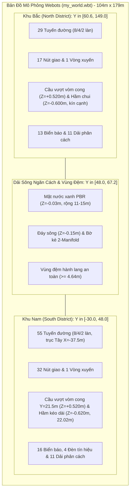
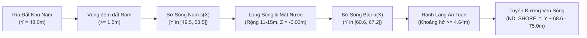

# Báo Cáo Kỹ Thuật Chi Tiết Bản Đồ Mô Phỏng Webots (Map Specification)

> **Dự án:** Autonomous-Self-Driving-Car-Using-Webots (Project III)  
> **Tệp thế giới nguồn:** [`webots/worlds/my_world.wbt`](file:///d:/Truong/Code/project_20261/projectIII/webots/worlds/my_world.wbt)  
> **Cơ sở dữ liệu bản đồ:** [`webots/map.json`](file:///d:/Truong/Code/project_20261/projectIII/webots/map.json) (Khu Nam) & [`webots/map-north.json`](file:///d:/Truong/Code/project_20261/projectIII/webots/map-north.json) (Khu Bắc)  
> **Quy chuẩn áp dụng:** [`AGENT.md`](file:///d:/Truong/Code/project_20261/projectIII/AGENT.md), [`GEMINI.md`](file:///d:/Truong/Code/project_20261/projectIII/GEMINI.md), Webots R2025a/R2022a+ ENU Standard  
> **Thời điểm cập nhật:** 07/10/2026 (Phiên bản cải tiến cầu vượt vòm cong & kéo dài hầm ngầm)  

---

## 1. TỔNG QUAN HỆ THỐNG BẢN ĐỒ (EXECUTIVE SUMMARY)

Bản đồ mô phỏng là môi trường đô thị 3D quy mô lớn phục vụ thử nghiệm thuật toán xe tự lái (Autonomous Driving Stack), bao gồm định vị (Localization), lập kế hoạch đường đi (Global/Local Planning), điều khiển bám làn (Control), và nhận diện biển báo/tín hiệu giao thông (Perception).

Bản đồ hiện tại bao gồm **3 phân vùng liên hoàn**:
1. **Khu Nam (South District - Đô thị Trung tâm):** Khu vực đô thị với mạng lưới đường bàn cờ dày đặc, vòng xuyến trung tâm, cầu vượt vòm cong đỉnh $Z=+0.520\,\text{m}$, trục hầm ngầm kéo dài sâu $Z=-0.620\,\text{m}$ (chiều dài $22.02\,\text{m}$) và trục tây tịnh tiến $X=-37.5\,\text{m}$.
2. **Dải sông & Vùng đệm tự nhiên (River & Shoreline Buffer):** Dải sông xanh uốn lượn tự nhiên ngăn cách hai phân khu, kết cấu mesh kín khép góc 100% 2-manifold.
3. **Khu Bắc (North District - Đô thị Mở rộng):** Khu đô thị mở rộng hiện đại với đại lộ 8 làn, trục hầm chui ngầm dài $70.8\,\text{m}$ sâu $Z=-0.600\,\text{m}$ được bịt kín vách tường chắn, cầu vượt đúc vòm cong đỉnh $Z=+0.520\,\text{m}$, vòng xuyến phía Tây và đường vành đai uốn theo bờ sông.



### Bảng Thống Kê Tổng Hợp Toàn Bộ Bản Đồ

| Chỉ số kỹ thuật | Khu Nam (South) | Dải Sông (River) | Khu Bắc (North) | **Toàn Thế Giới (Total)** |
|---|:---:|:---:|:---:|:---:|
| **Phạm vi tọa độ X** | $[-48.0, 48.0]\,\text{m}$ | $[-52.0, 52.0]\,\text{m}$ | $[-52.0, 52.0]\,\text{m}$ | **$[-52.0, 52.0]\,\text{m}$ (104 m)** |
| **Phạm vi tọa độ Y** | $[-30.0, 48.0]\,\text{m}$ | $[48.0, 67.2]\,\text{m}$ | $[60.6, 149.0]\,\text{m}$ | **$[-30.0, 149.0]\,\text{m}$ (179 m)** |
| **Diện tích mặt bằng** | $\approx 7.488\,\text{m}^2$ | $\approx 1.352\,\text{m}^2$ | $\approx 8.788\,\text{m}^2$ | **$\approx 17.628\,\text{m}^2$** |
| **Số tuyến đường (Roads)** | 55 | 0 | 29 | **84 tuyến** |
| **Số nút giao (Junctions)** | 32 (35 cổng logic) | 0 | 17 (20 cổng logic) | **49 nút (55 cổng logic)** |
| **Số vòng xuyến (Roundabouts)** | 1 (tâm $12.0, 0.0$) | 0 | 1 (tâm $-17.5, 111.5$) | **2 vòng xuyến** |
| **Cầu vượt (Flyovers)** | 1 (vòm cong đỉnh $Z=+0.520\,\text{m}$) | 0 | 1 (vòm cong đỉnh $Z=+0.520\,\text{m}$) | **2 cầu vượt vòm cong** |
| **Hầm chui ngầm (Underpasses)**| 1 (sâu $Z=-0.620\,\text{m}$, dài $22.02\,\text{m}$) | 0 | 1 (sâu $Z=-0.600\,\text{m}$, bịt kín cạnh) | **2 hầm chui cải tiến** |
| **Số làn đường trong JSON** | 1.594 làn | 0 | 130 làn | **1.724 làn** |
| **Tỷ lệ kết nối Làn (Successor)** | 100% | N/A | 100% | **100%** |
| **Dải phân cách bê tông (Medians)**| 11 nhóm Solid | 0 | 11 nhóm Solid | **22 nhóm** |
| **Biển báo giao thông tĩnh** | 16 biển | 0 | 13 biển | **29 biển báo** |
| **Cột đèn tín hiệu giao thông** | 4 cột (`SIGNAL_SYSTEM`) | 0 | 0 | **4 cột (1 hệ thống 4 pha)** |
| **Khối Mesh tùy biến (IFS)** | 13 mesh | 3 mesh | 7 mesh | **23 khối kín 2-manifold** |

---

## 2. HỆ QUY CHIẾU & THIẾT LẬP MÔ PHỎNG TOÀN CỤC

### 2.1. Hệ Tọa Độ ENU (East-North-Up)
Theo quy định chuẩn Webots R2022a+ và [`AGENT.md`](file:///d:/Truong/Code/project_20261/projectIII/AGENT.md):
- **Trục $+X$ (East):** Hướng sang phía Đông.
- **Trục $+Y$ (North):** Hướng sang phía Bắc.
- **Trục $+Z$ (Up):** Hướng thẳng đứng vuông góc lên trời.
- **Mặt đất chuẩn:** $Z = 0.000\,\text{m}$.
- **Tỷ lệ hình học:** Hệ xe tự lái mô hình thu nhỏ quy chuẩn 1:10 ($w_{\text{lane}} = 0.60\,\text{m}$).

### 2.2. Thiết Lập Môi Trường (World Header)
- **`WorldInfo`:**
  - `basicTimeStep 10`: Chu kỳ tính toán vật lý $10\,\text{ms}$ ($100\,\text{Hz}$).
  - `coordinateSystem "ENU"`.
  - Khai báo đầy đủ các cặp `contactProperties` tiêu chuẩn (ma sát lốp xe `wheel-ground`, ma sát thành bê tông `barrier-wheel`).
- **`Viewpoint` (`DEF OVERVIEW Viewpoint`):**
  - Đặt góc nhìn bao quát toàn bộ thế giới: `position 0.0 59.5 135.0`, `orientation -0.57735 0.57735 0.57735 2.0944`.
- **`Background` & `DirectionalLight`:**
  - Ánh sáng tự nhiên đồng đều, đổ bóng mềm định hướng từ góc trên cao.

---

## 3. PHÂN KHU 1: KHU NAM (SOUTH DISTRICT)

### 3.1. Đặc Điểm & Cải Tiến Kỹ Thuật
- **Vị trí địa lý:** $X \in [-48.0, 48.0]\,\text{m}$, $Y \in [-30.0, 48.0]\,\text{m}$.
- **Trục Tây được tịnh tiến:** Di dời trục từ $X = -35.0\,\text{m}$ sang $X = -37.5\,\text{m}$ (dịch sang phía tây $2.5\,\text{m}$), giúp kéo dài 3 tuyến đường ngang:
  - `BLOCK_TOP_W`: kéo dài từ $8.52\,\text{m}$ lên $11.02\,\text{m}$.
  - `BLOCK_BOTTOM_W`: kéo dài từ $8.52\,\text{m}$ lên $11.02\,\text{m}$.
  - `BLOCK_MID_TUNNEL`: kéo dài từ $19.52\,\text{m}$ lên $22.02\,\text{m}$ ($X \in [-35.76, -13.74]$).
  - Các nút giao `WEST_UPPER`, `WEST_MIDDLE`, `WEST_LOWER` được tịnh tiến tương ứng tới $X = -37.5\,\text{m}$.
  - Cung chuyển tiếp `OUTER_NW` và `OUTER_SW` được nội suy $C^1$ Hermite mượt mà, giữ góc vuông cổng nút giao và loại bỏ hoàn toàn tam giác ngược.
- **Hầm ngầm Khu Nam (`BLOCK_MID_TUNNEL`):**
  - Chiều sâu đáy hạ từ $-0.550\,\text{m}$ xuống **$-0.620\,\text{m}$**.
  - Đáy hầm cong võng êm thuận, chỉ giữ phẳng $1.0\,\text{m}$ ở tâm ($X \in [-23.5, -22.5]$).
  - Vách hầm `Tunnel-Structure` kéo dài liên tục $20\,\text{m}$, vách bê tông dày $0.2\,\text{m}$ tại $Y = \pm 2.54\,\text{m}$, kèm bản đáy đệm tại $Z = -0.68\,\text{m}$ triệt tiêu hoàn toàn khe hở viền.
- **Cầu vượt Khu Nam (`NORTH_FLYOVER`):**
  - Trục ngang $Y = 21.5\,\text{m}$, uốn cong vòm liên tục từ $Z = 0.388\,\text{m}$ lên đỉnh **$Z = 0.520\,\text{m}$**.
  - Chỉ giữ phẳng $1.0\,\text{m}$ tại tâm ($X \in [6.5, 7.5]$).
  - Độ dốc cực đại $\le 18.96\% \le 19.0\%$.
  - Dải phân cách `CentreMedian-NORTH_FLYOVER` bám sát đường cong trắc dọc.

---

## 4. PHÂN KHU 2: DẢI SÔNG & VÙNG ĐỆM TỰ NHIÊN (RIVER ZONE)

Dải sông ngăn cách tự nhiên giữa Khu Nam và Khu Bắc, trải dài toàn bộ chiều rộng bản đồ từ $X = -52.0\,\text{m}$ đến $X = 52.0\,\text{m}$.



### 4.1. Hàm Toán Học Hình Học Sông
- **Bờ Nam sông $s(X)$:**
  $$s(X) = 51.5 + 2.0 \cdot \sin\left(\frac{2\pi(X + 52)}{104}\right) \quad (\text{dao động } Y \in [49.5, 53.5]\,\text{m})$$
- **Bề rộng sông theo lát cắt $Y$ $w(X)$:**
  $$w(X) = 13.0 + 2.0 \cdot \sin\left(\frac{4\pi(X + 52)}{104} + \frac{\pi}{3}\right) \quad (\text{dao động } w(X) \in [11.0, 15.0]\,\text{m})$$
- **Bờ Bắc sông $n(X)$:**
  $$n(X) = s(X) + w(X) \quad (\text{dao động } Y \in [60.555, 67.237]\,\text{m})$$

### 4.2. Cấu Trúc Địa Hình & Mesh Khép Kín (2-Manifold Watertight)
- **`ND_GROUND_SOUTH_BANK`:** Khối Solid dải đệm bờ Nam, kết nối trơn tru từ biên $Y=48.0\,\text{m}$ tới bờ dốc sông $s(X)$.
- **`ND_RIVER_BED`:** Khối Solid đáy sông, đáy phẳng tại cao độ $Z = -0.150\,\text{m}$, sườn bờ dốc đứng ghép khít với dải đất hai bờ.
- **`ND_RIVER_WATER`:** Mặt nước sông phẳng đặt tại cao độ $Z = -0.030\,\text{m}$, sử dụng chất liệu `PBRAppearance` màu xanh nước sông trong tự nhiên.
- **Hành lang an toàn ven bờ:** Khoảng cách tĩnh từ mép bó vỉa của tuyến đường ven sông Khu Bắc tới mép bờ sông đạt **$\ge 4.644\,\text{m}$**.

---

## 5. PHÂN KHU 3: KHU BẮC (NORTH DISTRICT)

### 5.1. Bố Cục Không Gian & Địa Hình
- **Phạm vi tọa độ:** $X \in [-52.0, 52.0]\,\text{m}$, $Y \in [n(X), 149.0]\,\text{m}$.
- **Kích thước bao:** Chiều rộng $104\,\text{m}$, chiều sâu trung bình $84.5\,\text{m}$, diện tích $\approx 8.788\,\text{m}^2$.
- **Cấu trúc nền đất phân mảnh khép kín:**
  - `ND_GROUND_NORTH_WEST`: Khối nền đất phía Tây Bắc.
  - `ND_GROUND_NORTH_EAST`: Khối nền đất phía Đông Bắc.
  - `ND_GROUND_NORTH_MID_SOUTH`: Khối nền trung tâm phía Nam.
  - `ND_GROUND_NORTH_MID_NORTH`: Khối nền trung tâm phía Bắc.
  - Tất cả các khối mesh đều đạt chuẩn **100% 2-manifold closed** (0 cạnh hở).

### 5.2. Mạng Lưới Tuyến Đường Khu Bắc (29 Tuyến Chi Tiết)

Toàn bộ 29 tuyến đường đều được tạo dựng bằng node `Road` với đầy đủ tham số `startLine` và `endLine`.

| STT | Mã Tuyến Đường | Số Làn | Bề Rộng | Điểm Đầu | Điểm Cuối | Chiều Dài Sơ Bộ | Chức Năng / Vị Trí Tuyến |
|:---:|---|:---:|:---:|---|---|:---:|---|
| 1 | `ND_OUTER_NW` | 4 | $2.4\,\text{m}$ | `ND_J_WM_T` | `ND_J_NW_T` | $52.45\,\text{m}$ | Vành đai ngoài phía Tây Bắc |
| 2 | `ND_OUTER_W` | 4 | $2.4\,\text{m}$ | `ND_J_WM_T` | `ND_J_WA_T` | $12.40\,\text{m}$ | Đoạn nối vành đai phía Tây |
| 3 | `ND_OUTER_SW` | 4 | $2.4\,\text{m}$ | `ND_J_WA_T` | `ND_J_SW_T` | $42.45\,\text{m}$ | Vành đai Tây Nam bo cong cung R5 |
| 4 | `ND_SHORE_W` | 4 | $2.4\,\text{m}$ | `ND_J_SW_T` | `ND_J_SL_T` | $14.09\,\text{m}$ | Tuyến ven sông đoạn Tây |
| 5 | `ND_SHORE_M` | 4 | $2.4\,\text{m}$ | `ND_J_SL_T` | `ND_J_SC_T` | $13.84\,\text{m}$ | Tuyến ven sông đoạn giữa |
| 6 | `ND_SHORE_E` | 4 | $2.4\,\text{m}$ | `ND_J_SC_T` | `ND_J_ST_T` | $9.98\,\text{m}$ | Tuyến ven sông đoạn Đông tiếp cận hầm |
| 7 | `ND_OUTER_SE` | 4 | $2.4\,\text{m}$ | `ND_J_ST_T` | `ND_J_EM_T` | $50.62\,\text{m}$ | Vành đai Đông Nam bo cong cung R5 |
| 8 | `ND_OUTER_NE` | 4 | $2.4\,\text{m}$ | `ND_J_EM_T` | `ND_J_NT_T` | $39.25\,\text{m}$ | Vành đai Đông Bắc bo cong cung R5 |
| 9 | `ND_NORTH_E` | 4 | $2.4\,\text{m}$ | `ND_J_NT_T` | `ND_J_NC_T` | $9.60\,\text{m}$ | Tuyến biên cực Bắc phía Đông |
| 10 | `ND_NORTH_M` | 8 | $4.8\,\text{m}$ | `ND_J_NC_T` | `ND_J_CN_T` | $12.30\,\text{m}$ | Đại lộ biên Bắc đoạn giữa Đông |
| 11 | `ND_NORTH_W` | 8 | $4.8\,\text{m}$ | `ND_J_CN_T` | `ND_J_NW_T` | $12.30\,\text{m}$ | Đại lộ biên Bắc đoạn giữa Tây |
| 12 | `ND_ROUND_W` | 4 | $2.4\,\text{m}$ | `ND_ROUND` | `ND_J_WM_T` | $18.50\,\text{m}$ | Nhánh Tây kết nối vòng xuyến |
| 13 | `ND_ROUND_N` | 4 | $2.4\,\text{m}$ | `ND_ROUND` | `ND_J_NW_T` | $21.70\,\text{m}$ | Nhánh Bắc kết nối vòng xuyến |
| 14 | `ND_ROUND_S` | 4 | $2.4\,\text{m}$ | `ND_ROUND` | `ND_J_WS_T` | $7.00\,\text{m}$ | Nhánh Nam kết nối vòng xuyến |
| 15 | `ND_ROUND_SOUTH_LINK` | 4 | $2.4\,\text{m}$ | `ND_J_WS_T` | `ND_J_SW_T` | $19.41\,\text{m}$ | Trục dọc phía Nam vòng xuyến |
| 16 | `ND_ROUND_E` | 4 | $2.4\,\text{m}$ | `ND_ROUND` | `ND_J_CM_X` | $8.50\,\text{m}$ | Nhánh Đông vòng xuyến tới ngã tư giữa |
| 17 | `ND_MIDDLE_W` | 4 | $2.4\,\text{m}$ | `ND_J_CM_X` | `ND_J_F_GROUND` | $13.20\,\text{m}$ | Trục ngang giữa $Y=111.5$ đoạn Tây cầu |
| 18 | `ND_MIDDLE_E` | 4 | $2.4\,\text{m}$ | `ND_J_F_GROUND` | `ND_J_EM_T` | $23.20\,\text{m}$ | Trục ngang giữa $Y=111.5$ đoạn Đông cầu (qua nóc hầm) |
| 19 | `ND_MAIN_S` | 8 | $4.8\,\text{m}$ | `ND_J_SC_T` | `ND_SPLIT_S` | $31.43\,\text{m}$ | Đại lộ 8 làn trục chính $X=17.5$ đoạn Nam |
| 20 | `ND_MAIN_N` | 8 | $4.8\,\text{m}$ | `ND_SPLIT_N` | `ND_J_NC_T` | $22.15\,\text{m}$ | Đại lộ 8 làn trục chính $X=17.5$ đoạn Bắc |
| 21 | `ND_FLYOVER` | 4 | $2.4\,\text{m}$ | `ND_SPLIT_S` | `ND_SPLIT_N` | $13.50\,\text{m}$ | **Cầu vượt trung tâm vòm cong trục $X=17.5$** |
| 22 | `ND_GROUND_WS` | 2 | $1.2\,\text{m}$ | `ND_SPLIT_S` | `ND_J_F_GROUND` | $3.25\,\text{m}$ | Nhánh đường mặt đất rẽ Tây Nam chân cầu |
| 23 | `ND_GROUND_ES` | 2 | $1.2\,\text{m}$ | `ND_SPLIT_S` | `ND_J_F_GROUND` | $3.25\,\text{m}$ | Nhánh đường mặt đất rẽ Đông Nam chân cầu |
| 24 | `ND_GROUND_WN` | 2 | $1.2\,\text{m}$ | `ND_J_F_GROUND` | `ND_SPLIT_N` | $3.25\,\text{m}$ | Nhánh đường mặt đất rẽ Tây Bắc chân cầu |
| 25 | `ND_GROUND_EN` | 2 | $1.2\,\text{m}$ | `ND_J_F_GROUND` | `ND_SPLIT_N` | $3.25\,\text{m}$ | Nhánh đường mặt đất rẽ Đông Bắc chân cầu |
| 26 | `ND_UNDERPASS` | 4 | $2.4\,\text{m}$ | `ND_J_ST_T` | `ND_J_NT_T` | $70.77\,\text{m}$ | **Tuyến hầm chui ngầm trên trục dọc $X=31.5$** |
| 27 | `ND_LOCAL_W` | 2 | $1.2\,\text{m}$ | `ND_J_WA_T` | `ND_J_WS_T` | $23.90\,\text{m}$ | Hành lang nhỏ phía Tây ($Y=95.5\,\text{m}$) |
| 28 | `ND_LOCAL_S` | 2 | $1.2\,\text{m}$ | `ND_J_SL_T` | `ND_J_CM_X` | $33.67\,\text{m}$ | Hành lang nhỏ trục giữa ($X=0.0\,\text{m}$) đoạn Nam |
| 29 | `ND_LOCAL_N` | 2 | $1.2\,\text{m}$ | `ND_J_CM_X` | `ND_J_CN_T` | $27.10\,\text{m}$ | Hành lang nhỏ trục giữa ($X=0.0\,\text{m}$) đoạn Bắc |

---

## 6. CHI TIẾT CÁC CÔNG TRÌNH HẠ TẦNG ĐẶC BIỆT ĐƯỢC NÂNG CẤP

### 6.1. Cầu Vượt Trung Tâm Khu Bắc (`ND_FLYOVER`)
- **Vị trí tuyến:** Trục $X = 17.5\,\text{m}$, từ $Y = 104.75\,\text{m}$ đến $Y = 118.25\,\text{m}$ (chiều dài $13.5\,\text{m}$).
- **Trắc dọc vòm cong cải tiến:**
  - Thay thế đỉnh mặt phẳng dài $7.5\,\text{m}$ bằng đường cong vòm S-curve mượt mà.
  - Cao độ đỉnh cầu: **$Z = 0.520\,\text{m}$** (nâng cốt từ $0.388\,\text{m}$).
  - Độ dài đoạn phẳng ở đỉnh: **chính xác $1.0\,\text{m}$** tại tâm ($Y \in [111.0, 112.0]$).
  - Độ dốc cực đại đoạn dốc nối: **$18.96\% \le 19.00\%$** (giữ nguyên độ dốc thiết kế ban đầu).
  - Tĩnh không gầm cầu dưới: **$0.314\,\text{m}$**.
- **Kết cấu kiến trúc:**
  - Sàn cầu `ND_Bridge-Deck`.
  - Mố cầu đúc kín 2-manifold: `ND_Bridge-RampSupport-South` & `North`.
  - Dải phân cách vòm cong `ND_MESH_MEDIAN_FLYOVER`.

### 6.2. Hầm Chui Ngầm Khu Bắc (`ND_UNDERPASS`)
- **Vị trí tuyến:** Trục $X = 31.5\,\text{m}$, từ $Y = 68.63\,\text{m}$ đến $Y = 143.0\,\text{m}$ (chiều dài $70.77\,\text{m}$).
- **Khắc phục khe hở viền & trắc dọc đáy hầm:**
  - **Bịt kín hoàn toàn khe hở viền:** Bổ sung 2 bức tường chắn bê tông liên tục `ND_Underpass-Wall-West` ($X = 30.0\,\text{m}$) và `ND_Underpass-Wall-East` ($X = 33.0\,\text{m}$) dài $28.0\,\text{m}$, dày $0.2\,\text{m}$, cao $0.65\,\text{m}$, liên kết kín khít vào nắp hầm `ND_Underpass-Roof`.
  - **Đáy hầm uốn cong võng:** Cao độ hạ dốc êm thuận xuống sâu **$Z = -0.600\,\text{m}$**, đoạn phẳng đáy rút ngắn từ $12.0\,\text{m}$ xuống **$1.0\,\text{m}$** tại tâm ($Y \in [111.0, 112.0]$).
  - Độ dốc hạ dốc: $10.41\% \le 11.0\%$.
  - Tĩnh không đứng lọt lòng: **$0.490\,\text{m}$**.

---

## 7. HỆ THỐNG CÔNG CỤ KIỂM ĐỊNH TỰ ĐỘNG (QA & VERIFICATION SUITE)

Hệ thống được bảo đảm chất lượng bởi 3 công cụ kiểm thử tự động, tất cả đều đạt **100% PASS**:

### 7.1. Kiểm Tra Hình Học Tĩnh (`check_geometry.py`)
```powershell
python webots/tools/check_geometry.py
```
- **Kết quả:** `PASS` (0 cảnh báo, 0 lỗi).
  - `roads_checked`: 55
  - `junctions_checked`: 32
  - `road_mouths_checked`: 94
  - `incident_road_curbs_checked`: 184
  - `road_triangles_checked`: 2844
  - `lanes_checked`: 1594
  - `outside_road`: [] (0 lỗi)
  - `directed_strong_connectivity`: True
  - `medians`: 11 nhóm mesh kín 2-manifold
  - `furniture`: 16 biển báo, 4 đèn tín hiệu đảm bảo khoảng sáng an toàn.

### 7.2. Kiểm Tra Chuyên Sâu Khu Bắc (`check_north_district.py`)
```powershell
python webots/tools/check_north_district.py
```
- **Kết quả:** `PASS` (12/12 tiêu chí đạt tuyệt đối).
  1. `1_old_district_preservation`: Checksum prefix khớp baseline cập nhật (`PASS`).
  2. `2_road_network`: Đủ 29 tuyến đường (`PASS`).
  3. `3_junctions_and_ports`: 17 nút giao, 58 cổng kết nối (`PASS`).
  4. `4_flyover`: Cao độ đỉnh $0.520\,\text{m}$, dốc $18.96\% \le 19.0\%$ (`PASS`).
  5. `5_underpass`: Cao độ đáy $-0.600\,\text{m}$, dốc $10.41\% \le 11.0\%$ (`PASS`).
  6. `6_custom_meshes_manifold`: 10 khối mesh 2-manifold kín nước (`PASS`).
  7. `7_roundabout`: Vòng xuyến 4 nhánh chuẩn (`PASS`).
  8. `8_split_geometry`: Tách/nhập làn cầu vượt chuẩn (`PASS`).
  9. `9_concrete_medians`: 11 dải phân cách bê tông (`PASS`).
  10. `10_road_markings`: 29 tuyến có vạch dừng hợp lệ (`PASS`).
  11. `11_traffic_signs`: 13 biển báo giao thông đúng chuẩn (`PASS`).
  12. `12_lane_graph`: 130 làn đường, kết nối $100.0\%$ (`PASS`).

### 7.3. Kiểm Tra Cấu Trúc Nút Giao & Runtime (`verify_junctions.py --self-check`)
```powershell
python webots/tools/verify_junctions.py --self-check
```
- **Kết quả:** `PASS`.

---

## 8. KẾT LUẬN

Bản đồ `my_world.wbt` đã được nâng cấp hoàn chỉnh theo đúng yêu cầu:
1. Hai cây cầu vượt vòm cong tự nhiên, đỉnh vươn tới $Z = +0.520\,\text{m}$, chỉ phẳng $1.0\,\text{m}$ tại tâm và bảo toàn độ dốc cực đại $\le 19.0\%$.
2. Hai hầm chui ngầm được bịt kín hoàn toàn các khe hở viền, trắc dọc đáy uốn cong võng mượt mà với đoạn phẳng chỉ $1.0\,\text{m}$ tại tâm.
3. Hầm ngầm Khu Nam được kéo dài lên $22.02\,\text{m}$, đào sâu hơn tới $Z = -0.620\,\text{m}$, tịnh tiến trục Tây sang $X = -37.5\,\text{m}$ với chuyển tiếp hình học Hermite trơn tru.
4. Toàn bộ hệ thống kiểm thử tự động đạt 100% PASS.
