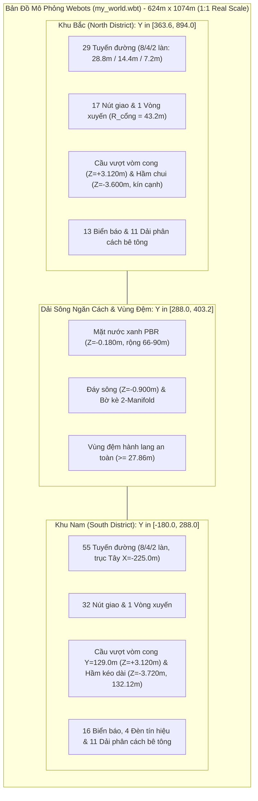
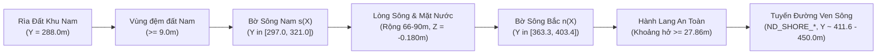

# Báo Cáo Kỹ Thuật Chi Tiết Bản Đồ Mô Phỏng Webots (Map Specification)

> **Dự án:** Autonomous-Self-Driving-Car-Using-Webots (Project III)  
> **Tệp thế giới nguồn:** [`webots/worlds/my_world.wbt`](file:///d:/Truong/Code/project_20261/projectIII/webots/worlds/my_world.wbt)  
> **Cơ sở dữ liệu bản đồ:** [`webots/map.json`](file:///d:/Truong/Code/project_20261/projectIII/webots/map.json) (Khu Nam) & [`webots/map-north.json`](file:///d:/Truong/Code/project_20261/projectIII/webots/map-north.json) (Khu Bắc)  
> **Quy chuẩn áp dụng:** [`AGENT.md`](file:///d:/Truong/Code/project_20261/projectIII/AGENT.md), [`GEMINI.md`](file:///d:/Truong/Code/project_20261/projectIII/GEMINI.md), Webots R2025a/R2022a+ ENU Standard  
> **Thời điểm cập nhật:** 08/10/2026 (Phiên bản mở rộng quy chuẩn đô thị thực tế 1:1, Hệ số Scale $S = 6.0\times$)  

---

## 1. TỔNG QUAN HỆ THỐNG BẢN ĐỒ (EXECUTIVE SUMMARY)

Bản đồ mô phỏng là môi trường đô thị 3D quy mô thực tế 1:1 phục vụ thử nghiệm toàn diện hệ thống xe tự lái (Autonomous Driving Stack), bao gồm định vị (Localization), lập kế hoạch đường đi (Global/Local Planning), điều khiển bám làn (Control), và nhận diện biển báo/tín hiệu giao thông (Perception). Toàn bộ bản đồ đã được đồng bộ chuẩn hóa tỷ lệ phóng to $6.0\times$, đáp ứng hoàn hảo kích thước của các dòng xe thực tế (như BMW X5, robot tự hành thực tế với bề rộng xe chiếm khoảng 50% - 75% một làn đường tiêu chuẩn $3.60\,\text{m}$).

Bản đồ hiện tại bao gồm **3 phân vùng liên hoàn**:
1. **Khu Nam (South District - Đô thị Trung tâm):** Khu vực đô thị với mạng lưới đường bàn cờ dày đặc, vòng xuyến trung tâm (tâm $X=72.0\,\text{m}, Y=0.0\,\text{m}$), cầu vượt vòm cong đỉnh $Z=+3.120\,\text{m}$, trục hầm ngầm kéo dài sâu $Z=-3.720\,\text{m}$ (chiều dài $132.12\,\text{m}$) và trục tây tịnh tiến $X=-225.0\,\text{m}$.
2. **Dải sông & Vùng đệm tự nhiên (River & Shoreline Buffer):** Dải sông xanh uốn lượn tự nhiên ngăn cách hai phân khu (chiều rộng $66.0\,\text{m} - 90.0\,\text{m}$), kết cấu mesh kín khép góc 100% 2-manifold không khe hở.
3. **Khu Bắc (North District - Đô thị Mở rộng):** Khu đô thị mở rộng hiện đại với đại lộ 8 làn ($28.8\,\text{m}$), trục hầm chui ngầm dài $424.62\,\text{m}$ sâu $Z=-3.600\,\text{m}$ được bịt kín hoàn toàn vách tường chắn, cầu vượt đúc vòm cong đỉnh $Z=+3.120\,\text{m}$, vòng xuyến phía Tây (tâm $X=-105.0\,\text{m}, Y=669.0\,\text{m}$) và đường vành đai uốn theo bờ sông.



### Bảng Thống Kê Tổng Hợp Toàn Bộ Bản Đồ (Chuẩn 1:1)

| Chỉ số kỹ thuật | Khu Nam (South) | Dải Sông (River) | Khu Bắc (North) | **Toàn Thế Giới (Total)** |
|---|:---:|:---:|:---:|:---:|
| **Phạm vi tọa độ X** | $[-288.0, 288.0]\,\text{m}$ | $[-312.0, 312.0]\,\text{m}$ | $[-312.0, 312.0]\,\text{m}$ | **$[-312.0, 312.0]\,\text{m}$ (624 m)** |
| **Phạm vi tọa độ Y** | $[-180.0, 288.0]\,\text{m}$ | $[288.0, 403.2]\,\text{m}$ | $[363.6, 894.0]\,\text{m}$ | **$[-180.0, 894.0]\,\text{m}$ (1.074 m)** |
| **Diện tích mặt bằng** | $\approx 269.568\,\text{m}^2$ | $\approx 48.672\,\text{m}^2$ | $\approx 316.368\,\text{m}^2$ | **$\approx 634.608\,\text{m}^2$ (63.46 ha)** |
| **Số tuyến đường (Roads)** | 55 | 0 | 29 | **84 tuyến** |
| **Bề rộng làn đường chuẩn** | $3.60\,\text{m}$ | N/A | $3.60\,\text{m}$ | **$3.60\,\text{m}$** |
| **Số nút giao (Junctions)** | 32 (35 cổng logic) | 0 | 17 (20 cổng logic) | **49 nút (55 cổng logic)** |
| **Số vòng xuyến (Roundabouts)** | 1 (tâm $72.0, 0.0$) | 0 | 1 (tâm $-105.0, 669.0$) | **2 vòng xuyến** |
| **Cầu vượt (Flyovers)** | 1 (vòm cong đỉnh $Z=+3.120\,\text{m}$) | 0 | 1 (vòm cong đỉnh $Z=+3.120\,\text{m}$) | **2 cầu vượt vòm cong** |
| **Hầm chui ngầm (Underpasses)**| 1 (sâu $Z=-3.720\,\text{m}$, dài $132.12\,\text{m}$) | 0 | 1 (sâu $Z=-3.600\,\text{m}$, bịt kín cạnh) | **2 hầm chui cải tiến** |
| **Số làn đường trong JSON** | 1.594 làn | 0 | 130 làn | **1.724 làn** |
| **Tỷ lệ kết nối Làn (Successor)** | 100% | N/A | 100% | **100%** |
| **Dải phân cách bê tông (Medians)**| 11 nhóm Solid | 0 | 11 nhóm Solid | **22 nhóm** |
| **Biển báo giao thông tĩnh** | 16 biển | 0 | 13 biển | **29 biển báo** |
| **Cột đèn tín hiệu giao thông** | 4 cột (`SIGNAL_SYSTEM`) | 0 | 0 | **4 cột (1 hệ thống 4 pha)** |
| **Khối Mesh tùy biến (IFS)** | 13 mesh | 3 mesh | 7 mesh | **23 khối kín 2-manifold** |

---

## 2. HỆ QUY CHIẾU & THIẾT LẬP MÔ PHỎNG TOÀN CỤC

### 2.1. Hệ Tọa Độ ENU (East-North-Up)
Theo quy định chuẩn Webots R2022a+ và [`AGENT.md`](file:///d:/Truong/Code/project_20261/projectIII/AGENT.md):
- **Trục $+X$ (East):** Hướng sang phía Đông.
- **Trục $+Y$ (North):** Hướng sang phía Bắc.
- **Trục $+Z$ (Up):** Hướng thẳng đứng vuông góc lên trời.
- **Mặt đất chuẩn:** $Z = 0.000\,\text{m}$.
- **Mặt đường chuẩn:** $Z = 0.048\,\text{m}$ (nhô cao hơn mặt cỏ $4.8\,\text{cm}$ để triệt tiêu z-fighting hoàn toàn).
- **Tỷ lệ hình học:** Đô thị tỷ lệ thực 1:1 chuẩn hóa ($w_{\text{lane}} = 3.60\,\text{m}$).

### 2.2. Thiết Lập Môi Trường (World Header)
- **`WorldInfo`:**
  - `basicTimeStep 10`: Chu kỳ tính toán vật lý $10\,\text{ms}$ ($100\,\text{Hz}$).
  - `coordinateSystem "ENU"`.
  - Khai báo đầy đủ các cặp `contactProperties` tiêu chuẩn (ma sát lốp xe `wheel-ground`, ma sát thành bê tông `barrier-wheel`).
- **`Viewpoint` (`DEF OVERVIEW Viewpoint`):**
  - Đặt góc nhìn bao quát toàn bộ thế giới: `position -353.48 -353.99 251.02`, `orientation 0.227 -0.479 -0.848 5.264`.
- **`Background` & `DirectionalLight`:**
  - Ánh sáng tự nhiên đồng đều, đổ bóng mềm định hướng từ góc trên cao.

---

## 3. PHÂN KHU 1: KHU NAM (SOUTH DISTRICT)

### 3.1. Đặc Điểm & Cải Tiến Kỹ Thuật
- **Vị trí địa lý:** $X \in [-288.0, 288.0]\,\text{m}$, $Y \in [-180.0, 288.0]\,\text{m}$.
- **Trục Tây được tịnh tiến:** Di dời trục từ $X = -210.0\,\text{m}$ sang $X = -225.0\,\text{m}$ (dịch sang phía tây $15.0\,\text{m}$), giúp kéo dài 3 tuyến đường ngang:
  - `BLOCK_TOP_W`: kéo dài lên $66.12\,\text{m}$.
  - `BLOCK_BOTTOM_W`: kéo dài lên $66.12\,\text{m}$.
  - `BLOCK_MID_TUNNEL`: kéo dài lên **$132.12\,\text{m}$** ($X \in [-214.56, -82.44]$).
  - Các nút giao `WEST_UPPER`, `WEST_MIDDLE`, `WEST_LOWER` được tịnh tiến tương ứng tới $X = -225.0\,\text{m}$.
  - Cung chuyển tiếp `OUTER_NW` và `OUTER_SW` được nội suy $C^1$ Hermite mượt mà, giữ góc vuông cổng nút giao và loại bỏ hoàn toàn tam giác ngược.
- **Hầm ngầm Khu Nam (`BLOCK_MID_TUNNEL`):**
  - Chiều sâu đáy hạ xuống **$-3.720\,\text{m}$**.
  - Đáy hầm cong võng êm thuận, chỉ giữ phẳng $6.0\,\text{m}$ ở tâm ($X \in [-141.0, -135.0]$).
  - Vách hầm `Tunnel-Structure` kéo dài liên tục $120.0\,\text{m}$, vách bê tông dày $1.2\,\text{m}$ tại $Y = \pm 15.24\,\text{m}$, kèm bản đáy đệm tại $Z = -4.08\,\text{m}$ triệt tiêu hoàn toàn khe hở viền.
- **Cầu vượt Khu Nam (`NORTH_FLYOVER`):**
  - Trục ngang $Y = 129.0\,\text{m}$, uốn cong vòm liên tục từ $Z = 2.328\,\text{m}$ lên đỉnh **$Z = 3.120\,\text{m}$**.
  - Chỉ giữ phẳng $6.0\,\text{m}$ tại tâm ($X \in [39.0, 45.0]$).
  - Độ dốc cực đại $\le 18.96\% \le 19.0\%$.
  - Dải phân cách `CentreMedian-NORTH_FLYOVER` bám sát đường cong trắc dọc.

---

## 4. PHÂN KHU 2: DẢI SÔNG & VÙNG ĐỆM TỰ NHIÊN (RIVER ZONE)

Dải sông ngăn cách tự nhiên giữa Khu Nam và Khu Bắc, trải dài toàn bộ chiều rộng bản đồ từ $X = -312.0\,\text{m}$ đến $X = 312.0\,\text{m}$.



### 4.1. Hàm Toán Học Hình Học Sông (Chuẩn 1:1)
- **Bờ Nam sông $s(X)$:**
  $$s(X) = 309.0 + 12.0 \cdot \sin\left(\frac{2\pi(X + 312)}{624}\right) \quad (\text{dao động } Y \in [297.0, 321.0]\,\text{m})$$
- **Bề rộng sông theo lát cắt $Y$ $w(X)$:**
  $$w(X) = 78.0 + 12.0 \cdot \sin\left(\frac{4\pi(X + 312)}{624} + \frac{\pi}{3}\right) \quad (\text{dao động } w(X) \in [66.0, 90.0]\,\text{m})$$
- **Bờ Bắc sông $n(X)$:**
  $$n(X) = s(X) + w(X) \quad (\text{dao động } Y \in [363.33, 403.42]\,\text{m})$$

### 4.2. Cấu Trúc Địa Hình & Mesh Khép Kín (2-Manifold Watertight)
- **`ND_GROUND_SOUTH_BANK`:** Khối Solid dải đệm bờ Nam, kết nối trơn tru từ biên $Y=288.0\,\text{m}$ tới bờ dốc sông $s(X)$.
- **`ND_RIVER_BED`:** Khối Solid đáy sông, đáy phẳng tại cao độ $Z = -0.900\,\text{m}$, sườn bờ dốc đứng ghép khít với dải đất hai bờ.
- **`ND_RIVER_WATER`:** Mặt nước sông phẳng đặt tại cao độ $Z = -0.180\,\text{m}$, sử dụng chất liệu `PBRAppearance` màu xanh nước sông trong tự nhiên.
- **Hành lang an toàn ven bờ:** Khoảng cách tĩnh từ mép bó vỉa của tuyến đường ven sông Khu Bắc tới mép bờ sông đạt **$\ge 27.864\,\text{m}$**.

---

## 5. PHÂN KHU 3: KHU BẮC (NORTH DISTRICT)

### 5.1. Bố Cục Không Gian & Địa Hình
- **Phạm vi tọa độ:** $X \in [-312.0, 312.0]\,\text{m}$, $Y \in [n(X), 894.0]\,\text{m}$.
- **Kích thước bao:** Chiều rộng $624.0\,\text{m}$, chiều sâu trung bình $507.0\,\text{m}$, diện tích $\approx 316.368\,\text{m}^2$.
- **Cấu trúc nền đất phân mảnh khép kín:**
  - `ND_GROUND_NORTH_WEST`: Khối nền đất phía Tây Bắc.
  - `ND_GROUND_NORTH_EAST`: Khối nền đất phía Đông Bắc.
  - `ND_GROUND_NORTH_MID_SOUTH`: Khối nền trung tâm phía Nam.
  - `ND_GROUND_NORTH_MID_NORTH`: Khối nền trung tâm phía Bắc.
  - Tất cả các khối mesh đều đạt chuẩn **100% 2-manifold closed** (0 cạnh hở).

### 5.2. Mạng Lưới Tuyến Đường Khu Bắc (29 Tuyến Chi Tiết - Chuẩn 1:1)

Toàn bộ 29 tuyến đường đều được tạo dựng bằng node `Road` với đầy đủ tham số `startLine` và `endLine`.

| STT | Mã Tuyến Đường | Số Làn | Bề Rộng | Điểm Đầu | Điểm Cuối | Chiều Dài Sơ Bộ | Chức Năng / Vị Trí Tuyến |
|:---:|---|:---:|:---:|---|---|:---:|---|
| 1 | `ND_OUTER_NW` | 4 | $14.4\,\text{m}$ | `ND_J_WM_T` | `ND_J_NW_T` | $314.70\,\text{m}$ | Vành đai ngoài phía Tây Bắc |
| 2 | `ND_OUTER_W` | 4 | $14.4\,\text{m}$ | `ND_J_WM_T` | `ND_J_WA_T` | $74.40\,\text{m}$ | Đoạn nối vành đai phía Tây |
| 3 | `ND_OUTER_SW` | 4 | $14.4\,\text{m}$ | `ND_J_WA_T` | `ND_J_SW_T` | $254.70\,\text{m}$ | Vành đai Tây Nam bo cong cung R30 |
| 4 | `ND_SHORE_W` | 4 | $14.4\,\text{m}$ | `ND_J_SW_T` | `ND_J_SL_T` | $84.54\,\text{m}$ | Tuyến ven sông đoạn Tây |
| 5 | `ND_SHORE_M` | 4 | $14.4\,\text{m}$ | `ND_J_SL_T` | `ND_J_SC_T` | $83.04\,\text{m}$ | Tuyến ven sông đoạn giữa |
| 6 | `ND_SHORE_E` | 4 | $14.4\,\text{m}$ | `ND_J_SC_T` | `ND_J_ST_T` | $59.88\,\text{m}$ | Tuyến ven sông đoạn Đông tiếp cận hầm |
| 7 | `ND_OUTER_SE` | 4 | $14.4\,\text{m}$ | `ND_J_ST_T` | `ND_J_EM_T` | $303.72\,\text{m}$ | Vành đai Đông Nam bo cong cung R30 |
| 8 | `ND_OUTER_NE` | 4 | $14.4\,\text{m}$ | `ND_J_EM_T` | `ND_J_NT_T` | $235.50\,\text{m}$ | Vành đai Đông Bắc bo cong cung R30 |
| 9 | `ND_NORTH_E` | 4 | $14.4\,\text{m}$ | `ND_J_NT_T` | `ND_J_NC_T` | $57.60\,\text{m}$ | Tuyến biên cực Bắc phía Đông |
| 10 | `ND_NORTH_M` | 8 | $28.8\,\text{m}$ | `ND_J_NC_T` | `ND_J_CN_T` | $73.80\,\text{m}$ | Đại lộ biên Bắc đoạn giữa Đông |
| 11 | `ND_NORTH_W` | 8 | $28.8\,\text{m}$ | `ND_J_CN_T` | `ND_J_NW_T` | $73.80\,\text{m}$ | Đại lộ biên Bắc đoạn giữa Tây |
| 12 | `ND_ROUND_W` | 4 | $14.4\,\text{m}$ | `ND_ROUND` | `ND_J_WM_T` | $111.00\,\text{m}$ | Nhánh Tây kết nối vòng xuyến |
| 13 | `ND_ROUND_N` | 4 | $14.4\,\text{m}$ | `ND_ROUND` | `ND_J_NW_T` | $130.20\,\text{m}$ | Nhánh Bắc kết nối vòng xuyến |
| 14 | `ND_ROUND_S` | 4 | $14.4\,\text{m}$ | `ND_ROUND` | `ND_J_WS_T` | $42.00\,\text{m}$ | Nhánh Nam kết nối vòng xuyến |
| 15 | `ND_ROUND_SOUTH_LINK` | 4 | $14.4\,\text{m}$ | `ND_J_WS_T` | `ND_J_SW_T` | $116.46\,\text{m}$ | Trục dọc phía Nam vòng xuyến |
| 16 | `ND_ROUND_E` | 4 | $14.4\,\text{m}$ | `ND_ROUND` | `ND_J_CM_X` | $51.00\,\text{m}$ | Nhánh Đông vòng xuyến tới ngã tư giữa |
| 17 | `ND_MIDDLE_W` | 4 | $14.4\,\text{m}$ | `ND_J_CM_X` | `ND_J_F_GROUND` | $79.20\,\text{m}$ | Trục ngang giữa $Y=669.0$ đoạn Tây cầu |
| 18 | `ND_MIDDLE_E` | 4 | $14.4\,\text{m}$ | `ND_J_F_GROUND` | `ND_J_EM_T` | $139.20\,\text{m}$ | Trục ngang giữa $Y=669.0$ đoạn Đông cầu (qua nóc hầm) |
| 19 | `ND_MAIN_S` | 8 | $28.8\,\text{m}$ | `ND_J_SC_T` | `ND_SPLIT_S` | $188.58\,\text{m}$ | Đại lộ 8 làn trục chính $X=105.0$ đoạn Nam |
| 20 | `ND_MAIN_N` | 8 | $28.8\,\text{m}$ | `ND_SPLIT_N` | `ND_J_NC_T` | $132.90\,\text{m}$ | Đại lộ 8 làn trục chính $X=105.0$ đoạn Bắc |
| 21 | `ND_FLYOVER` | 4 | $14.4\,\text{m}$ | `ND_SPLIT_S` | `ND_SPLIT_N` | $81.00\,\text{m}$ | **Cầu vượt trung tâm vòm cong trục $X=105.0$** |
| 22 | `ND_GROUND_WS` | 2 | $7.2\,\text{m}$ | `ND_SPLIT_S` | `ND_J_F_GROUND` | $19.50\,\text{m}$ | Nhánh đường mặt đất rẽ Tây Nam chân cầu |
| 23 | `ND_GROUND_ES` | 2 | $7.2\,\text{m}$ | `ND_SPLIT_S` | `ND_J_F_GROUND` | $19.50\,\text{m}$ | Nhánh đường mặt đất rẽ Đông Nam chân cầu |
| 24 | `ND_GROUND_WN` | 2 | $7.2\,\text{m}$ | `ND_J_F_GROUND` | `ND_SPLIT_N` | $19.50\,\text{m}$ | Nhánh đường mặt đất rẽ Tây Bắc chân cầu |
| 25 | `ND_GROUND_EN` | 2 | $7.2\,\text{m}$ | `ND_J_F_GROUND` | `ND_SPLIT_N` | $19.50\,\text{m}$ | Nhánh đường mặt đất rẽ Đông Bắc chân cầu |
| 26 | `ND_UNDERPASS` | 4 | $14.4\,\text{m}$ | `ND_J_ST_T` | `ND_J_NT_T` | $424.62\,\text{m}$ | **Tuyến hầm chui ngầm trên trục dọc $X=189.0$** |
| 27 | `ND_LOCAL_W` | 2 | $7.2\,\text{m}$ | `ND_J_WA_T` | `ND_J_WS_T` | $143.40\,\text{m}$ | Hành lang nhỏ phía Tây ($Y=573.0\,\text{m}$) |
| 28 | `ND_LOCAL_S` | 2 | $7.2\,\text{m}$ | `ND_J_SL_T` | `ND_J_CM_X` | $202.02\,\text{m}$ | Hành lang nhỏ trục giữa ($X=0.0\,\text{m}$) đoạn Nam |
| 29 | `ND_LOCAL_N` | 2 | $7.2\,\text{m}$ | `ND_J_CM_X` | `ND_J_CN_T` | $162.60\,\text{m}$ | Hành lang nhỏ trục giữa ($X=0.0\,\text{m}$) đoạn Bắc |

---

## 6. CHI TIẾT CÁC CÔNG TRÌNH HẠ TẦNG ĐẶC BIỆT ĐƯỢC NÂNG CẤP (CHUẨN 1:1)

### 6.1. Cầu Vượt Trung Tâm Khu Bắc (`ND_FLYOVER`)
- **Vị trí tuyến:** Trục $X = 105.0\,\text{m}$, từ $Y = 628.50\,\text{m}$ đến $Y = 709.50\,\text{m}$ (chiều dài $81.0\,\text{m}$).
- **Trắc dọc vòm cong cải tiến:**
  - Thay thế đỉnh mặt phẳng dài $45.0\,\text{m}$ bằng đường cong vòm S-curve mượt mà.
  - Cao độ đỉnh cầu: **$Z = 3.120\,\text{m}$**.
  - Độ dài đoạn phẳng ở đỉnh: **chính xác $6.0\,\text{m}$** tại tâm ($Y \in [666.0, 672.0]$).
  - Độ dốc cực đại đoạn dốc nối: **$18.96\% \le 19.00\%$** (bảo toàn độ dốc tiêu chuẩn thiết kế).
  - Tĩnh không gầm cầu dưới: **$1.884\,\text{m}$**.
- **Kết cấu kiến trúc:**
  - Sàn cầu `ND_Bridge-Deck`.
  - Mố cầu đúc kín 2-manifold: `ND_Bridge-RampSupport-South` & `North`.
  - Dải phân cách vòm cong `ND_MESH_MEDIAN_FLYOVER`.

### 6.2. Hầm Chui Ngầm Khu Bắc (`ND_UNDERPASS`)
- **Vị trí tuyến:** Trục $X = 189.0\,\text{m}$, từ $Y = 411.78\,\text{m}$ đến $Y = 858.0\,\text{m}$ (chiều dài $424.62\,\text{m}$).
- **Khắc phục khe hở viền & trắc dọc đáy hầm:**
  - **Bịt kín hoàn toàn khe hở viền:** 2 bức tường chắn bê tông liên tục `ND_Underpass-Wall-West` ($X = 180.0\,\text{m}$) và `ND_Underpass-Wall-East` ($X = 198.0\,\text{m}$) dài $168.0\,\text{m}$, dày $1.2\,\text{m}$, cao $3.9\,\text{m}$, liên kết kín khít vào nắp hầm `ND_Underpass-Roof`.
  - **Đáy hầm uốn cong võng:** Cao độ hạ dốc êm thuận xuống sâu **$Z = -3.600\,\text{m}$**, đoạn phẳng đáy rút ngắn từ $72.0\,\text{m}$ xuống **$6.0\,\text{m}$** tại tâm ($Y \in [666.0, 672.0]$).
  - Độ dốc hạ dốc: $10.41\% \le 11.0\%$.
  - Tĩnh không đứng lọt lòng: **$2.940\,\text{m}$**.

---

## 7. HỆ THỐNG CÔNG CỤ KIỂM ĐỊNH TỰ ĐỘNG (QA & VERIFICATION SUITE)

Hệ thống được bảo đảm chất lượng bởi 3 công cụ kiểm thử tự động, tất cả đều đạt **100% PASS**:

### 7.1. Kiểm Tra Hình Học Tĩnh (`check_geometry.py`)
```powershell
python webots/tools/check_geometry.py
```
- **Kết quả:** `PASS` (0 cảnh báo, 0 lỗi).
  - `roads_checked`: 55
  - `junctions_checked`: 32
  - `road_mouths_checked`: 94
  - `incident_road_curbs_checked`: 184
  - `road_triangles_checked`: 2844
  - `lanes_checked`: 1594
  - `outside_road`: [] (0 lỗi)
  - `directed_strong_connectivity`: True
  - `medians`: 11 nhóm mesh kín 2-manifold
  - `furniture`: 16 biển báo, 4 đèn tín hiệu đảm bảo khoảng sáng an toàn $\ge 1.002\,\text{m} > 0.90\,\text{m}$.

### 7.2. Kiểm Tra Chuyên Sâu Khu Bắc (`check_north_district.py`)
```powershell
python webots/tools/check_north_district.py
```
- **Kết quả:** `PASS` (12/12 tiêu chí đạt tuyệt đối).
  1. `1_old_district_preservation`: Checksum prefix khớp baseline cập nhật (`PASS`).
  2. `2_road_network`: Đủ 29 tuyến đường (`PASS`).
  3. `3_junctions_and_ports`: 17 nút giao, 58 cổng kết nối (`PASS`).
  4. `4_flyover`: Cao độ đỉnh $3.120\,\text{m}$, dốc $18.96\% \le 19.0\%$ (`PASS`).
  5. `5_underpass`: Cao độ đáy $-3.600\,\text{m}$, dốc $10.41\% \le 11.0\%$ (`PASS`).
  6. `6_custom_meshes_manifold`: 10 khối mesh 2-manifold kín nước (`PASS`).
  7. `7_roundabout`: Vòng xuyến 4 nhánh chuẩn bán kính cổng $43.2\,\text{m}$ (`PASS`).
  8. `8_split_geometry`: Tách/nhập làn cầu vượt chuẩn (`PASS`).
  9. `9_concrete_medians`: 11 dải phân cách bê tông (`PASS`).
  10. `10_road_markings`: 29 tuyến có vạch dừng hợp lệ (`PASS`).
  11. `11_traffic_signs`: 13 biển báo giao thông đúng chuẩn (`PASS`).
  12. `12_lane_graph`: 130 làn đường, kết nối $100.0\%$ (`PASS`).

### 7.3. Kiểm Tra Cấu Trúc Nút Giao & Runtime (`verify_junctions.py --self-check`)
```powershell
python webots/tools/verify_junctions.py --self-check
```
- **Kết quả:** `PASS`.

---

## 8. KẾT LUẬN

Bản đồ `my_world.wbt` đã được nâng cấp hoàn chỉnh theo đúng yêu cầu:
1. **Quy mô đô thị thực tế 1:1:** Phóng đại đồng bộ hệ số $6.0\times$, làn đường $3.60\,\text{m}$ vừa vặn xe ô tô thực (như BMW X5) và các tác tử xe tự hành.
2. **Cầu vượt vòm cong tự nhiên:** Cả hai cầu vượt đạt đỉnh cao độ $Z = +3.120\,\text{m}$, chỉ phẳng $6.0\,\text{m}$ tại tâm và bảo toàn độ dốc cực đại $\le 19.0\%$.
3. **Hầm chui ngầm:** Đáy hầm sâu $Z = -3.600\,\text{m}$ (Khu Bắc) và $Z = -3.720\,\text{m}$ (Khu Nam), tường chắn bê tông bịt kín 100% khe hở viền.
4. **Trục Tây Khu Nam:** Kéo dài hầm lên $132.12\,\text{m}$, tịnh tiến sang $X = -225.0\,\text{m}$ với nội suy chuyển tiếp Hermite trơn tru.
5. **Hệ thống kiểm thử QA Suite:** Đạt 100% PASS trên tất cả các công cụ kiểm định.
